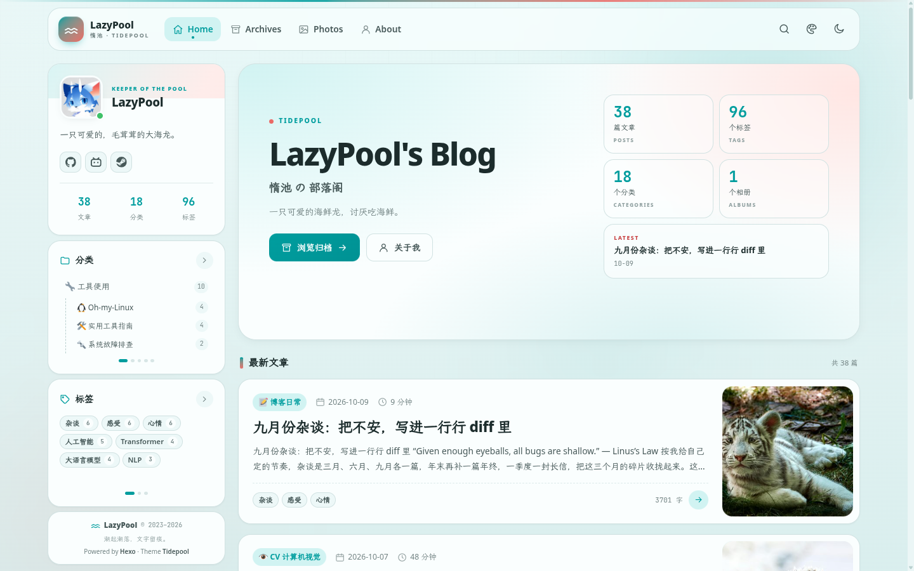

# LazyPool's Blog

<p align="center">
  LazyPool's personal blog · code, papers, tools and life
</p>

<p align="center">
  
  
  = 22">
  
  
  
</p>

<p align="center">
  <strong>English</strong> | <a href="./README-zh.md">简体中文</a>
</p>

<p align="center">
  
</p>

Built with [Hexo](https://hexo.io/) and the custom **Tidepool** theme. The site uses a low-saturation
tide-pool palette, card-based layouts and restrained micro-interactions. The legacy Fluid theme
and its related assets have been removed.

## Features

- **Seamless navigation**: Swup 4 replaces page content in place, keeping the navbar and sidebar alive while reading.
- **Distinct visual system**: OKLCH single-hue design tokens with four palettes (`tide`, `abyss`, `coral`, `kelp`) and light/dark modes.
- **Reading experience**: floating lyrics-style table of contents, reading progress, heading anchors, code copy, image lightbox and post navigation.
- **Local search**: a `search.json` index built at generation time; open the command palette with `Ctrl/⌘ + K` or `/`.
- **Infinite lists**: the home, category and tag post lists load in batches instead of using pagination.
- **Math**: KaTeX rendering, mobile-friendly display math and horizontal scrolling for tagged equations.
- **Responsive**: the sidebar is hidden on mobile and the home hero is condensed for smaller screens.
- **About page**: author profile, writing categories and a GitHub contribution heatmap.

## Tech Stack

- **Static site**: [Hexo 8](https://hexo.io/)
- **Theme**: Tidepool (`themes/tidepool/`)
- **Templates**: EJS
- **Styling**: Vanilla CSS + CSS Custom Properties
- **Interactions**: Vanilla JavaScript, Swup 4
- **Math**: KaTeX
- **Search**: Local JSON index + client-side search
- **Fonts**: LXGW WenKai, JetBrains Mono
- **Node.js**: >= 22

## Getting Started

```bash
git clone https://github.com/lazypool/blog.git
cd blog
npm install
npm run server
```

The local preview runs at <http://localhost:4000/> by default.

Main commands:

- `npm run server` — start the local development server
- `npm run build` — generate static files into `public/`
- `npm run clean` — remove generated files
- `npm run lint` — check EJS, Markdown, math and site configuration
- `npm run format` — normalize Markdown/math and format JSON/YAML with Prettier
- `npm run fix` — auto-fix issues that can be fixed safely
- `npm run deploy` — deploy after configuring `deploy` in `_config.yml`

Content-quality scripts:

- `post-filters.js`: CJK bold fixes, soft line breaks and math underscore escaping
- `check-math.js`: KaTeX syntax and math structure checks
- `format-md.js`: paragraph reflow and math normalization
- `check-site.js`: image paths, date folders and tag/category hygiene
- `sync-source.js`: sync `_pages` and `_assets`

Run `npm run lint` and `npm run format` before committing. The current `npm run lint` result is
**0 errors / 0 warnings**.

Deployment:

`npm run build` writes the site to `public/`. To use `hexo deploy`, configure the `deploy` section
in `_config.yml` first. You can also publish `public/` directly to GitHub Pages, Cloudflare Pages
or any static host.

## Project Structure

```text
├── source/
│   ├── _assets/         # Shared images, mirrored into source/ at build time
│   ├── _pages/          # Standalone pages (about / photo)
│   └── _posts/          # Posts
├── themes/
│   └── tidepool/        # Current theme
│       ├── layout/      # EJS layouts and partials
│       ├── scripts/     # Helpers, search index, 404 route
│       └── source/      # CSS, JS and Swup dependencies
├── scripts/             # Site-level Hexo scripts
├── docs/                # README assets
├── _config.yml          # Main Hexo configuration
├── _config.tidepool.yml # Tidepool theme configuration
└── public/              # Build output
```

## Theme & Colors

Theme options live in `_config.tidepool.yml`:

- Navigation menu, author profile and social links
- Home hero and album-count placeholder
- Feature switches for search, TOC, reading progress, code copy and image lightbox
- Default palettes: `tide`, `abyss`, `coral`, `kelp`

Color tokens are maintained in `themes/tidepool/source/css/tokens.css`. Color and visual changes
must go through `themes/tidepool/`; do not add root-level `css/` or `js/`, and do not put CSS/JS in
`source/_assets`.

## Acknowledgements

- [Hexo](https://hexo.io/) for static site generation
- [Swup](https://swup.js.org/) for seamless page navigation
- [KaTeX](https://katex.org/) for math rendering
- [LXGW WenKai](https://github.com/lxgw/LxgwWenKai) for the body font
- [JetBrains Mono](https://www.jetbrains.com/lp/mono/) for the code font
- [Shields.io](https://shields.io/) for README badges

---

<p align="center">
  <sub>Made with <a href="https://hexo.io/">Hexo</a> · Theme <strong>Tidepool</strong> · Tides rise and fall; words remain.</sub>
</p>
